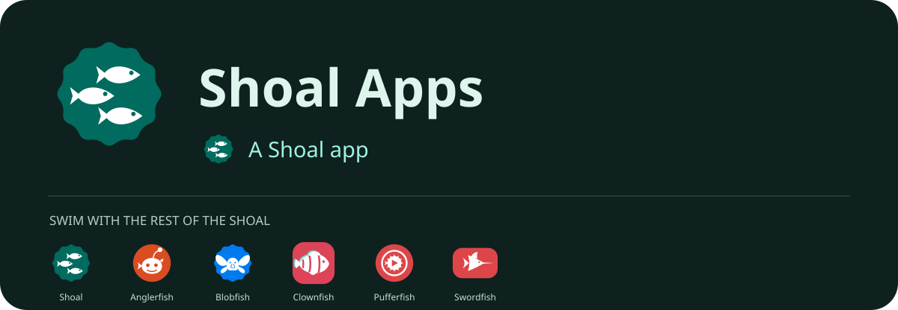

The website for [Shoal](https://github.com/ShoalApps): open-source Android apps that take on your
wallpaper's colours with Material You.

A single static page. Colours are generated with Google's
[material-color-utilities](https://github.com/material-foundation/material-color-utilities), and the
credits are fetched live from GitHub. Pushing to `main` publishes it with GitHub Pages.

Free software under the GPL-3.0.

## Support

Shoal is free, open source and has no ads. If you'd like to help it keep going, you can [support Shoal on Liberapay](https://liberapay.com/ShoalApps).

## Fish motion

Fish motion is in `assets/ocean.css` and `assets/ocean.js`. It honours reduced motion, includes a persistent pause control, and pauses decorative motion when the page is hidden.

## README headers

The app README headers use self-contained SVGs in `assets/readme/`. An hourly workflow discovers Android repositories in ShoalApps and regenerates every app's header, including the icons of its siblings. New Android apps with the standard launcher vector and colour files are included automatically. `.shoal-app.json` can supply a display name, description or alternative icon paths. Run `python scripts/readme-headers.py --local-root /path/to/checkouts` for a local preview. GitHub may cache README images briefly.
